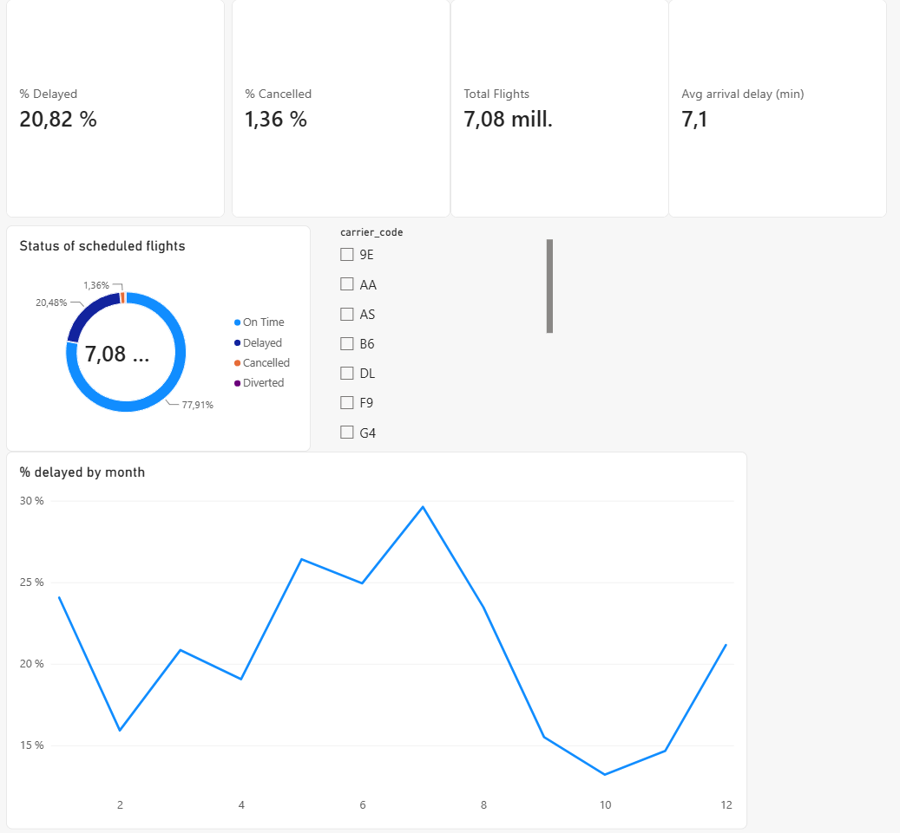
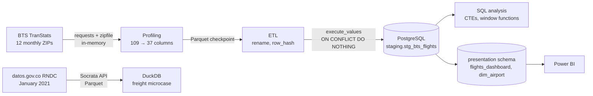

# Operations & Logistics Analytics: U.S. Flight Delays 2024 and a Colombian Freight Microcase

End-to-end operations analytics project on **7.08 million U.S. domestic flights** (calendar year 2024). The pipeline goes from bulk extraction of public government files, through an idempotent ETL into PostgreSQL, to SQL analysis of delay patterns and a presentation layer for a Power BI dashboard.

The questions are operational ones: where delays concentrate, which carriers and routes perform worst, what causes the most lost minutes, and how predictable each route is.



The full Power BI report (four pages: overview, carriers, delay causes, airports and time) is in [`dashboard/flight_operations.pdf`](dashboard/flight_operations.pdf).

---

## Business questions

1. Which carriers and routes have the highest average delay?
2. Within each route, which carrier performs worst?
3. Which delay causes account for most of the lost minutes (Pareto)?
4. Which routes are the least predictable, beyond their average delay?
5. What share of flights miss the 15-minute on-time standard, and how long are delays once they happen?
6. How do delays propagate from one flight to the next along an aircraft's daily rotation?
7. Which airports act as ground bottlenecks, and when (hour, day) do problems concentrate?

---

## Data source

**BTS Reporting Carrier On-Time Performance (1987–present)**, published monthly by the U.S. Department of Transportation, Bureau of Transportation Statistics (TranStats).

| | |
|---|---|
| Coverage | January to December 2024 |
| Granularity | One row per scheduled flight |
| Raw size | 7,079,061 rows × 109 fields (12 monthly ZIP files, ~27 MB each) |
| Columns kept | 37 (schedule vs. actual times, delays, delay causes, cancellations, route, carrier) |
| Access | Pre-generated monthly ZIP files (`transtats.bts.gov/PREZIP/`), no API |

The raw data is not included in this repository. Notebook 01 downloads it directly from BTS.

### Why this dataset

I originally planned this project around Colombian freight trucking data (RNDC logistics times, Ministerio de Transporte, via datos.gov.co). After building the first extraction and staging steps, I confirmed that the public resource only contained a single month (January 2021) and had not been updated since, so it couldn't support any trend or comparison analysis. I dropped it and looked for a transport dataset with real temporal coverage, cause attribution and enough volume to make SQL worth using. BTS On-Time Performance met all three. One month of that data still made it into the project as a short microcase (Notebook 05).

---

## Pipeline



Notebooks 01–04 form the BTS pipeline. Notebook 05 is a separate branch with its own source and engine and doesn't touch PostgreSQL.

---

## Notebooks

| # | Notebook | What it does |
|---|---|---|
| 01 | `01_bulk_download_and_profiling.ipynb` | Validates the BTS URL pattern on one month, downloads all 12 months with retry logic, profiles the 109 BTS fields and narrows them to 37. Saves Parquet checkpoints. |
| 02 | `02_etl_postgresql_ingestion.ipynb` | Designs the staging table, builds a SHA-256 `row_hash` surrogate key (BTS has no natural record ID), loads 7M rows in 50K-row batches and validates the load. |
| 03 | `03_sql_delay_analysis.ipynb` | Answers the business questions with SQL against the staging table: carrier and route comparisons, delay-cause Pareto, variability, punctuality, delay propagation along aircraft rotations, taxi-out bottlenecks and disruption days. |
| 04 | `04_powerbi_presentation_layer.ipynb` | Builds a separate `presentation` schema for Power BI (fact table with business-friendly names and a derived on-time status, plus an airport dimension) and documents the connection. |
| 05 | `05_rndc_freight_microcase.ipynb` | Colombian freight microcase: downloads one month of road-freight records (RNDC, January 2021) from datos.gov.co, shows that each row is a consignment and weights rows so every trip counts once, then analyses waiting times, corridors and agreed vs paid value with DuckDB over Parquet. |

---

## SQL techniques used

- Aggregations with `GROUP BY` / `HAVING` (minimum of 100 flights per route to avoid unstable averages)
- CTEs to separate aggregation from ranking
- `RANK() OVER (PARTITION BY origin, dest ...)` for within-route carrier ranking, with `COUNT(*) OVER (PARTITION BY ...)` to keep only routes where carriers compete
- `LAG()` and `ROW_NUMBER()` over `PARTITION BY tail_number, flight_date` to rebuild each aircraft's daily rotation, with a tie-break on `row_hash` so the order is the same on every run
- `PERCENTILE_CONT() WITHIN GROUP` (with `FILTER`) for medians and 90th percentiles
- Windowed `SUM() OVER (ORDER BY ...)` for the cumulative Pareto percentage
- `SUM() OVER ()` for shares of total, with delay minutes cast to `double precision` so the sums are exact
- `COUNT(*) FILTER (WHERE ...)` for conditional rates
- `UNION ALL` to unpivot the five delay-cause columns into rows
- `CASE WHEN` for delay buckets, the dominant cancellation cause and the derived on-time status
- Date and time handling: `TO_CHAR`, scheduled hour from HHMM integers
- `STDDEV()` for route variability
- `CREATE TABLE AS SELECT` and indexes for the presentation layer
- `INSERT ... ON CONFLICT DO NOTHING` for idempotent loading
- In DuckDB (Notebook 05): weighted percentiles built from cumulative window sums, and `GROUP BY ROLLUP` for class totals

---

## Key findings

**Baseline.** 20.82% of flights that reached their destination arrived 15+ minutes late, 1.36% of scheduled flights were cancelled and 0.25% were diverted.

**Delays travel with the aircraft.** Late-arriving aircraft cause 40.4% of all delay minutes, the largest single cause. Rebuilding each aircraft's daily rotation with `LAG()` gives a picture consistent with delays carrying over: when a plane arrives 15–29 minutes late, the next departure is delayed 54% of the time, and turnarounds absorb almost none of the incoming delay (pass-through ratio close to 1 up to an hour). The share of delayed departures climbs from 12% on an aircraft's first leg of the day to 32% by the seventh, and from 9% of flights scheduled at 5 a.m. to 30% at 8 p.m. These figures are descriptive: a storm or a congested hub can delay consecutive legs at once, and the aircraft that fly seven legs a day aren't a typical sample.

**Carriers.** F9 and AA are late most often (28.7% and 26.1%). AA also has the longest tail (85.7 minutes on average once delayed, against a median of 46), while F9's delays are of ordinary length. On routes where carriers actually compete, AA is the worst carrier on 63.5% of routes, about 1.7 times the 36.8% that chance would predict. DL is the most reliable of the large carriers (17.3% delayed). WN's low average delay comes from short delays (median 36 minutes when delayed), not from being late less often.

**Worst routes aren't a weather story.** The routes with the highest average delays connect small mountain and resort airports (RDM, EGE, JAC, RNO) with hubs. I expected winter weather, but on these routes weather and NAS together explain less of the delay than the national average, while late aircraft and carrier causes dominate. On most of them the median flight arrives close to on time and a few extreme delays inflate the average.

**Bottlenecks and disruptions.** Taxi-out times are longest at JFK, EWR, LGA and O'Hare. The single worst day of 2024 was 19 July, the CrowdStrike IT outage, with 16.5% of flights cancelled; that event accounts for four of the ten days with the most cancellations, ahead of the January storms and Hurricane Milton.

**Colombian freight microcase.** One month of RNDC trucking data has 836K rows, but each row is a consignment, not a trip. Weighting each row by its trip's number of consignments gives about 670K trips. Two thirds of the waiting-time records hold just three values (0, 0.98 or 1 hour), so the source captures waiting poorly. Within that limit, long recorded waits concentrate on bulk-cargo corridors (coal, coke and crude oil heading to ports), Medellín's busiest corridors stay at or below 5 hours even at the 90th percentile, and agreed and paid freight values match on 97.8% of trips.

---

## Limitations

- One year of data (2024), so there is no year-over-year comparison.
- Covers only the carriers required to report to BTS; it isn't the full U.S. aviation system.
- Delay causes are reported by the airlines themselves, and BTS assigns non-extreme weather to the NAS category, so the weather share understates weather's total effect.
- Aircraft rotations are rebuilt from tail numbers within each calendar day. Overnight flights and cancelled legs break some chains; the 1.2% of legs that don't link consistently are excluded from the propagation analysis.
- All results are descriptive. Nothing here establishes causal effects.
- The Colombian microcase covers a single month (January 2021), and its waiting-time fields are dominated by a few default-looking values. The file has no trip ID, so trips are counted by weighting consignments; trips with stops in several municipalities are split across their corridors.
- `row_hash` depends on how pandas formats each value. A dtype change or a BTS revision of a monthly file would produce new hashes, so an incremental load would need a natural-key check as well.

---

## How to reproduce

**Requirements:** Python 3.12, PostgreSQL 15+, a notebook front end (`requirements.txt` includes JupyterLab; I used VS Code with the Jupyter extension), and optionally Power BI Desktop, whose PostgreSQL connector needs no extra driver.

1. Clone the repository and install dependencies:
   ```bash
   pip install -r requirements.txt
   ```
2. Create an empty database called `bts_flights_db` in PostgreSQL (I created it manually in pgAdmin).
3. Copy `.env.example` to `.env` in the project root and fill in your credentials:
   ```
   DB_USER=postgres
   DB_PASSWORD=
   DB_HOST=localhost
   DB_PORT=5432
   DB_NAME=bts_flights_db
   ```
4. Run the notebooks in order from the `notebooks/` folder; the paths to `.env`, `data/` and `outputs/` are resolved relative to it. Notebook 05 doesn't need PostgreSQL; it downloads one month from the datos.gov.co API (about 4 minutes).

Some practical notes. Notebook 01 took between 16 and 26 minutes in my runs to download the 12 files, depending on the BTS server, and needs several GB of free RAM while the full 112-column DataFrame (109 BTS fields, an empty trailing column and two added ones) is in memory. Computing `row_hash` in Notebook 02 takes 7 to 16 minutes and the first database load about 12 (re-running it over a full table takes longer, since every row goes through the conflict check). Once the Parquet checkpoints exist, Notebooks 02–04 can be re-run without downloading again, and the load can be repeated safely because of `ON CONFLICT DO NOTHING`.

---

## Repository structure

```
operations-logistics-analytics/
├── notebooks/
│   ├── 01_bulk_download_and_profiling.ipynb
│   ├── 02_etl_postgresql_ingestion.ipynb
│   ├── 03_sql_delay_analysis.ipynb
│   ├── 04_powerbi_presentation_layer.ipynb
│   ├── 05_rndc_freight_microcase.ipynb
│   └── checkpoints/          # Parquet files, git-ignored
├── data/
│   └── raw/                  # RNDC Parquet, git-ignored
├── dashboard/
│   ├── flight_operations.pbix
│   ├── flight_operations.pdf
│   └── screenshots/
├── outputs/
│   └── figures/
├── .env.example
├── .gitignore
├── LICENSE
├── requirements.txt
└── README.md
```

---

## Tools

Python (pandas, requests, SQLAlchemy, psycopg2, DuckDB, matplotlib) · PostgreSQL · pgAdmin 4 · Power BI Desktop

---

## License

Code under the MIT License (see `LICENSE`). The flight data comes from the U.S. Bureau of Transportation Statistics and the freight data from Colombia's open-data portal (datos.gov.co, Ministerio de Transporte, resource `tfrd-amb4`). The raw files aren't in the repository; the notebooks download both from their public sources. The one exception is `dashboard/flight_operations.pbix`, which embeds the imported BTS tables. BTS data is published by a U.S. federal agency and isn't subject to copyright in the United States. For the RNDC data, see the terms on the dataset's page at datos.gov.co.

---

## Author

**Juan Llanos** · [GitHub](https://github.com/juan-llanos)
